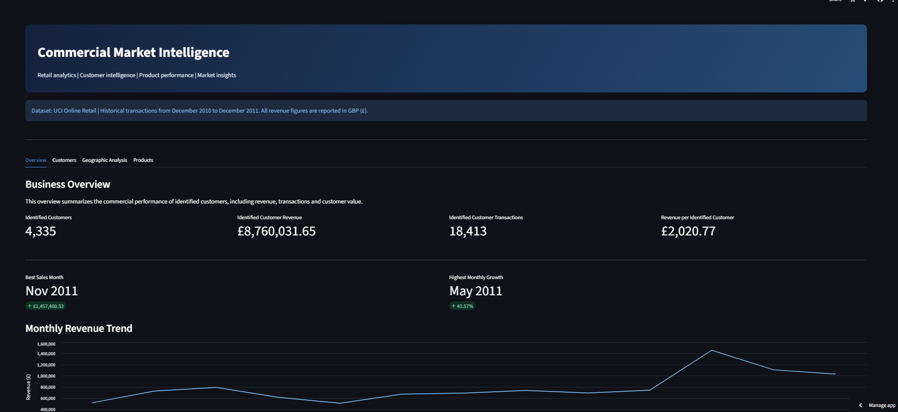
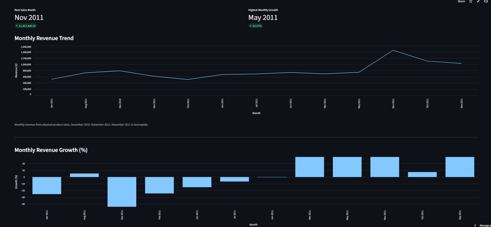
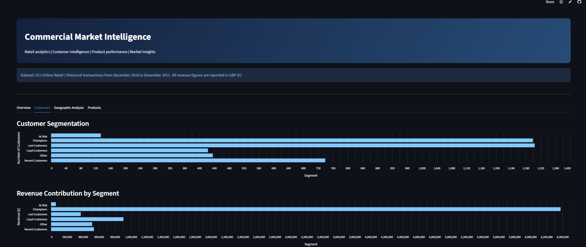
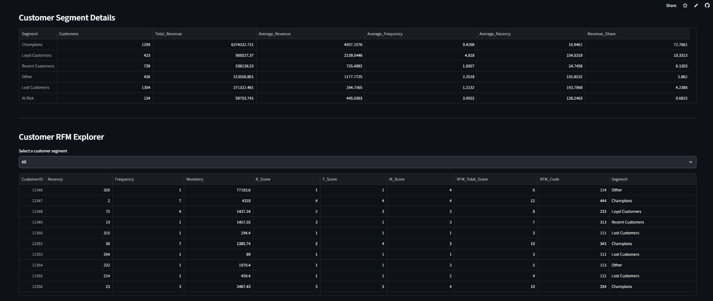
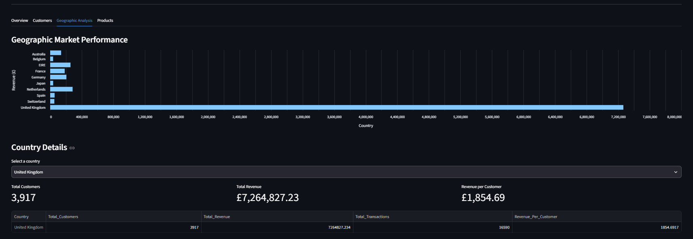
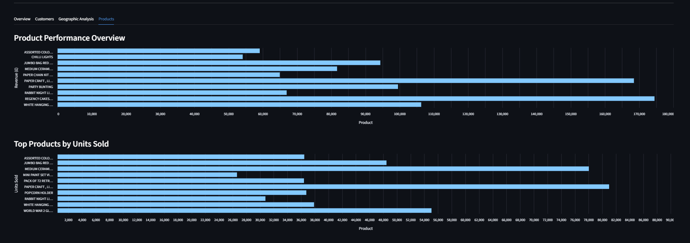
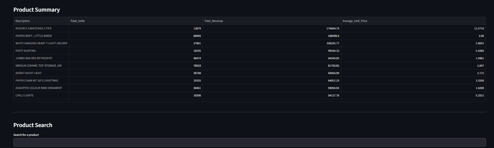
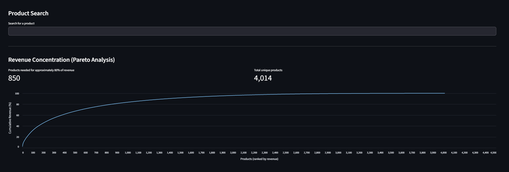

# Commercial Market Intelligence

[](https://commercial-market-intelligence-ujikepaephucbtc5itpssy.streamlit.app/)
[](https://www.python.org/)
[](https://streamlit.io/)

**Live Demo:** https://commercial-market-intelligence-ujikepaephucbtc5itpssy.streamlit.app/

**An end-to-end retail analytics project using Python, Pandas, and Streamlit to transform transactional data into actionable business insights.**

## Project Overview

This project analyzes historical online retail transactions to identify sales trends, evaluate product performance, understand customer behavior, and explore geographic market opportunities.

The objective is to transform raw transactional data into meaningful business insights through data cleaning, exploratory data analysis, customer segmentation, and interactive visualization.

## Business Objectives

- Analyze revenue trends and monthly sales performance.
- Identify top-performing products and revenue concentration.
- Evaluate geographic market performance.
- Segment customers using the RFM model.
- Build an interactive dashboard to explore business metrics.

## Dataset

**Source:** [UCI Machine Learning Repository – Online Retail](https://archive.ics.uci.edu/dataset/352/online+retail)

- Original records: 541,909
- Period: December 2010 – December 2011
- Business type: UK-based online retailer
- Original variables: 8

The dataset contains historical transactions, including product descriptions, quantities, prices, invoice dates, customer IDs, and countries.

## Technologies Used

- Python
- Pandas
- NumPy
- Matplotlib
- Seaborn
- Streamlit
- Jupyter Notebook
- Git and GitHub


## Project Structure

```text
commercial-market-intelligence/
│
├── data/
│   ├── raw/
│   └── processed/
│
├── notebooks/
│   └── 01_data_exploration.ipynb
│
├── src/
├── dashboard/
│   └── app.py
│
├── docs/
│   └── images/
│       ├── overview_top.png
│       ├── overview_bottom.png
│       ├── customers1.png
│       ├── customers2.png
│       ├── geographic1.png
│       ├── products1.png
│       ├── products2.png
│       └── products3.png
│
├── reports/
├── requirements.txt
├── README.md
└── .gitignore
```


## Methodology

The project follows a structured data analytics workflow:

1. **Data Understanding:** Explored the original dataset, reviewed its structure, variables, and data quality.
2. **Data Cleaning:** Identified missing values, cancellations, returns, zero-price records, and accounting adjustments.
3. **Data Transformation:** Classified transactions and separated physical product sales from shipping, administrative, and gift voucher records.
4. **Exploratory Data Analysis:** Analyzed product performance, revenue trends, geographic markets, and customer behavior.
5. **Customer Segmentation:** Applied Recency, Frequency, and Monetary (RFM) analysis to classify identified customers.
6. **Data Visualization:** Developed an interactive Streamlit dashboard to explore the results.

## Key Findings

### Product Performance
- Analyzed 4,148 product-code and description combinations.
- Approximately 20.73% of the product catalog generated 80.03% of physical product revenue.
- The top 10 products represented 9.41% of total physical product revenue.

### Geographic Analysis
- The United Kingdom accounted for approximately 85.18% of physical product revenue.
- The Netherlands, Ireland (EIRE), Germany, France, and Australia were among the leading international markets.
- The five largest international markets represented 71.09% of international revenue.

### Sales Trends
- November 2011 was the strongest month, generating approximately £1.46 million in physical product revenue.
- Monthly revenue analysis revealed periods of significant growth and decline.
- December 2011 contains incomplete data.

### Customer Intelligence
- Identified 4,335 unique customers with available customer IDs.
- Applied RFM analysis to classify customers according to purchasing behavior.
- Champions represented approximately 30% of identified customers and generated 72.77% of identified customer revenue.
- Lost Customers represented approximately 30% of identified customers but contributed only 4.24% of identified customer revenue.

## Interactive Dashboard

The Streamlit dashboard provides four analytical sections:

- **Overview:** Key business metrics and monthly revenue trends.
- **Customers:** RFM segmentation, customer distribution, and revenue contribution.
- **Geographic Analysis:** Country-level customer and revenue performance.
- **Products:** Top-performing products, product search, and revenue concentration analysis.


### Dashboard Preview

#### Overview





#### Customer Intelligence





#### Geographic Analysis



#### Product Performance








## Installation and Setup

### 1. Clone the Repository

```bash
git clone https://github.com/rubenalejandrorivera-eng/commercial-market-intelligence.git

cd commercial-market-intelligence
```

### 2. Create a Virtual Environment

```bash
python -m venv .venv
```

Activate it on Windows:

```powershell
.venv\Scripts\Activate.ps1
```

### 3. Install Dependencies

```bash
pip install -r requirements.txt
```

### 4. Download the Dataset

Download the Online Retail dataset from the [UCI Machine Learning Repository](https://archive.ics.uci.edu/dataset/352/online+retail).

Place the Excel file in:

```text
data/raw/Online Retail.xlsx
```

### 5. Generate Processed Data

Open and run all cells in:

```text
notebooks/01_data_exploration.ipynb
```

This notebook performs the data preparation and analysis and generates the processed CSV files required by the dashboard.

### 6. Launch the Dashboard

From the project root directory, run:

```bash
streamlit run dashboard/app.py
```

The dashboard will open in your browser at:

```text
http://localhost:8501
```

## Limitations and Considerations

- **Historical Data:** The dataset covers December 2010 to December 2011. Findings describe historical business performance and should not be interpreted as current market conditions.
- **Revenue vs. Profit:** The analysis measures transaction revenue, not profitability, because product costs and operating expenses are not available.
- **Customer Identification:** Approximately 24.93% of the original records do not contain a CustomerID. Customer segmentation therefore considers only identifiable customers.
- **Incomplete Period:** December 2011 contains transactions only through December 9.
- **RFM Segmentation:** Customer scores are based on relative quartiles within this dataset. Segment definitions are analytical classifications, not universal business standards.
- **Geographic Sample Sizes:** Some international markets have relatively few identified customers, so revenue-per-customer comparisons should be interpreted carefully.

## Author

**Ruben Rivera**

GitHub: [rubenalejandrorivera-eng](https://github.com/rubenalejandrorivera-eng)
